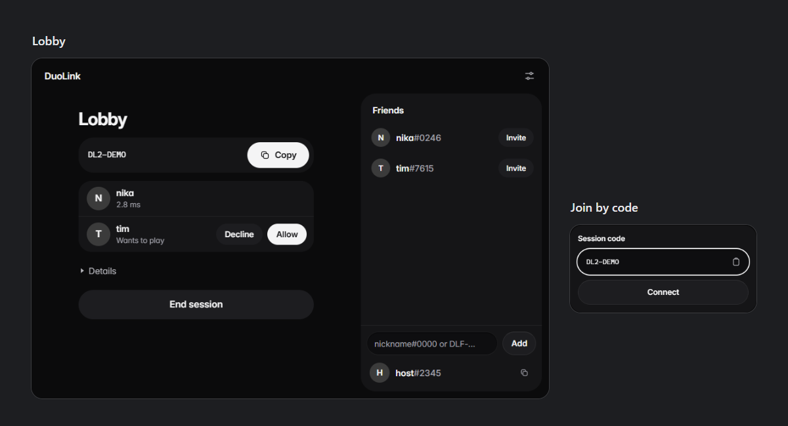

[Русский](README.md) | **English**

  <h1>DuoLink</h1>
  
Play local co-op and versus games online on Windows.

  
<strong>Join by code without an account. Works with games outside Steam.</strong>

  

    
    
    
  

  <h3><a href="https://github.com/roudinn/duolink/releases/latest/download/DuoLink.exe">Download DuoLink for Windows</a></h3>
  
<a href="https://github.com/roudinn/duolink/releases/latest">Portable build and release notes</a>

  

## How to invite a friend

| App | First session | What you can play |
| --- | --- | --- |
| **DuoLink** | **Send a code and approve your friend. Both players can play without an account.** | **Local co-op and versus games on and off Steam**, including fighting games from other stores and emulators with controller support |
| Parsec | Host and guest sign in to Parsec accounts, then connect | Apps and games on the host PC |
| Steam Remote Play Together | The host signs in to Steam, starts the game and sends an invite | Games that support Remote Play Together |

The game runs on the host PC. The guest sees the screen, hears the game and plays with their own gamepad. It appears as a separate controller on the host.

## First session

1. Download and run `DuoLink.exe` on both PCs.
2. Start the game on the host and select **Create session**.
3. Send the code to your friend. They select **Connect**, and the host selects **Allow**. Add the second player in the game.

> [!IMPORTANT]
> DuoLink needs WebView2. If it is missing, DuoLink offers to open [Microsoft's download page](https://developer.microsoft.com/microsoft-edge/webview2/#download). On the first session Windows may prompt to install ViGEmBus on the host. This driver provides the guest's gamepad to the game.

The main download is the installer. Extract the ZIP with `portable` in its name to run DuoLink from its own folder.

> [!WARNING]
> The current release EXE is unsigned. Windows may show a SmartScreen warning. Download the file from DuoLink's official release. If Windows blocks it, include the warning text in a bug report. [How Windows verifies publishers](https://learn.microsoft.com/windows/apps/package-and-deploy/code-signing-options)

## FAQ

Does my friend need a copy of the game?

The host's copy is enough. The guest needs DuoLink and a gamepad to play as a second player.

Can I join without a gamepad?

Yes, as a spectator. XInput games can see up to four controllers, including the host's. If the game supports controller changes during play, one guest can free a slot for another while staying in the stream.

What if both networks have strict NAT?

Try swapping the host or moving one PC to another network. If you can manage the router, check UPnP. A session needs a working direct route.

How do I invite a friend without copying a session code each time?

Open **Friends**, save a nickname and add your friend by their nickname and tag or the friend code in Settings. Once they accept, use **Invite**.

## Documentation

[Architecture and networking](docs/ARCHITECTURE.md) · [Build and self-host](docs/SELF_HOSTING.md) · [Report a bug](https://github.com/roudinn/duolink/issues/new?template=bug_report.yml)
