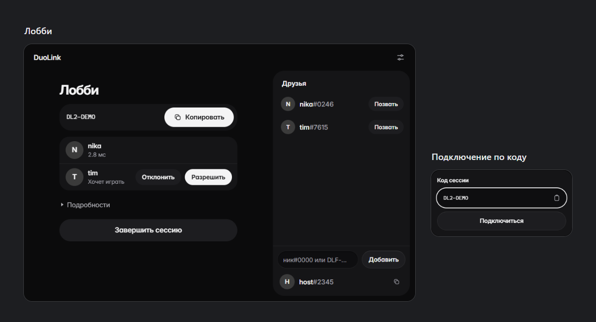

**Русский** | [English](README.en.md)

  <h1>DuoLink</h1>
  
Локальный кооператив и versus через интернет на Windows.

  
<strong>Вход по коду без аккаунтов. Без встроенных лимитов FPS и разрешения.</strong>

  

    
    
    
  

  <h3><a href="https://github.com/roudinn/duolink/releases/latest/download/DuoLink.exe">Скачать DuoLink для Windows</a></h3>
  
<a href="https://github.com/roudinn/duolink/releases/latest">Портативная версия и список изменений</a>

  

## Во что можно играть

Подойдут игры с локальным мультиплеером и поддержкой нескольких геймпадов, в том числе из Steam, других магазинов и в эмуляторах. Гость видит игру хоста и управляет отдельным контроллером.

## Первая игра

1. Скачайте и запустите `DuoLink.exe` на обоих ПК.
2. Запустите игру у хоста и нажмите «Создать сессию».
3. Отправьте другу код. Друг нажимает «Подключиться», хост нажимает «Разрешить». Добавьте второго игрока в самой игре.

> [!IMPORTANT]
> Для запуска нужен WebView2. DuoLink предложит [скачать его у Microsoft](https://developer.microsoft.com/microsoft-edge/webview2/#download), если компонент отсутствует. На первой сессии Windows может запросить установку ViGEmBus на ПК хоста. Он нужен для геймпадов гостей.

Ссылка в шапке ведёт прямо на установщик. ZIP со словом `portable` в имени подходит для запуска из распакованной папки.

> [!WARNING]
> EXE текущего релиза без цифровой подписи. Windows может показать предупреждение SmartScreen. Скачивайте файл из официального релиза DuoLink. Если Windows блокирует запуск, сохраните текст предупреждения и приложите его к отчёту. [Как Windows проверяет издателя](https://learn.microsoft.com/windows/apps/package-and-deploy/code-signing-options)

## FAQ

Другу нужна копия игры?

Достаточно копии у хоста. Гостю нужны DuoLink и геймпад, если он хочет играть за второго персонажа.

Можно подключиться без геймпада?

Да, в качестве зрителя. В играх на XInput доступно до четырёх контроллеров, включая контроллеры хоста. Если игра поддерживает смену геймпада на ходу, один гость может освободить место другому, оставаясь в трансляции.

Что делать при строгом NAT у обоих?

Обновите DuoLink на обоих ПК. Если прямое подключение не получается, DuoLink попробует пройти через ретранслятор. На резервном маршруте битрейт ограничен, а задержка зависит от пути до сервера.

Как сохранить друга и приглашать без копирования кода?

Откройте «Друзья», сохраните ник и добавьте друга по нику с тегом или по коду друга из настроек. Когда он примет запрос, используйте «Позвать».

## Документация

[Архитектура и сеть](docs/ARCHITECTURE.md) · [Конфиденциальность](docs/PRIVACY.md) · [Сообщить об ошибке](https://github.com/roudinn/duolink/issues/new?template=bug_report.yml)
