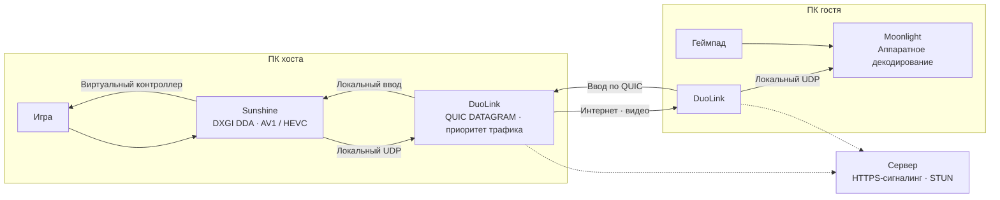

# Архитектура DuoLink

DuoLink состоит из Windows-клиента и Linux-сервиса сигналинга. Клиент запускает Sunshine на ПК хоста и Moonlight на ПК гостя, согласует параметры потока и связывает локальные порты обоих процессов прямым QUIC-соединением.

> [!NOTE]
> Пунктиром показан служебный трафик. VPS помогает найти прямой маршрут и доставить приглашение. Видео, звук и ввод проходят между ПК. Для сетей без рабочего прямого маршрута в v1.14.7 ретранслятора нет.

## Сессия

1. Код `DL2-` содержит параметры подключения. Гость проверяет доступные маршруты и сравнивает их по RTT. Среди вариантов есть локальная сеть, внешний порт через UPnP и адрес, который определил STUN.
2. Для UDP hole punching клиенты обмениваются зашифрованными адресами через сигналинг и отправляют друг другу пробные пакеты. После установления QUIC хост подтверждает гостя.
3. Sunshine слушает `127.0.0.1`, Moonlight на госте подключается к локальным портам, которые DuoLink открывает на `127.0.0.2`. TCP-обмен движков идёт по надёжным потокам QUIC. UDP-пакеты движков и отдельный канал звука используют QUIC DATAGRAM.
4. Sunshine передаёт гостевой ввод через виртуальный контроллер на ПК хоста. При выходе гостя DuoLink завершает его поток и освобождает занятый контроллер.

[Туннель](../src/tunnel.rs) · [Протокол](../src/protocol.rs) · [Жизненный цикл сессии](../src/session.rs)

## Задержка и сеть

| Механизм | Как работает |
| --- | --- |
| Таймер Windows | Во время трансляции клиент запрашивает `timeBeginPeriod(1)`, повышает приоритет обработки и возвращает настройки при выходе. Один миллисекундный период таймера не определяет задержку кадра. |
| QUIC DATAGRAM и приоритет | Дейтаграммы не требуют повторной доставки. Аудио и управление получают приоритет перед видео, когда очередь передачи заполнена. |
| MTU | Начальный размер UDP-пакета QUIC составляет 1200 байт. Клиент проверяет размер дейтаграммы и согласует видеопакет на 1136 или 1024 байта с запасом под RTP и служебные поля туннеля. |
| Адаптивный битрейт | Каждые 200 мс клиент измеряет сглаженный RTT и потери. При активном трафике рост RTT более чем на 20 мс над базовым значением в течение секунды снижает автобитрейт. Устойчивые потери вызывают более сильное снижение. Для смены битрейта гостевой поток открывается заново, поэтому возможна короткая пауза. |
| Захват и вывод | По умолчанию DuoLink использует Desktop Duplication, низколатентные пресеты Sunshine и аппаратное декодирование Moonlight. Автовыбор предпочитает AV1, затем HEVC при поддержке у обеих сторон. Доступные разрешение и FPS зависят от экрана, кодера, декодера и сети. |
| Звук | Отдельный захват игрового звука использует Opus с кадрами по 5 мс при поддержке на обоих клиентах. Для совместимости сохраняется PCM. Опоздавшие аудиопакеты отбрасываются. |

Пинг в лобби показывает сетевой RTT. Замер задержки от нажатия до изображения дополнительно включает игру, захват, кодирование, декодирование и экран.

[Приоритет датаграмм](../src/datagram.rs) · [Автобитрейт](../src/bitrate.rs) · [Звук](../src/audio.rs) · [Настройки движков](../src/media.rs) · [Таймер Windows](../src/platform.rs)

## Сервер

Rust-сервис за nginx обрабатывает каталог ников, зашифрованную почту и обмен адресами. Хранение использует SQLite. Два UDP-порта отвечают на STUN Binding. Для загрузки проверенных компонентов можно использовать зеркало.

[Описание API и нагрузочные тесты](../server/README.md) · [Свой сервер](SELF_HOSTING.md)
